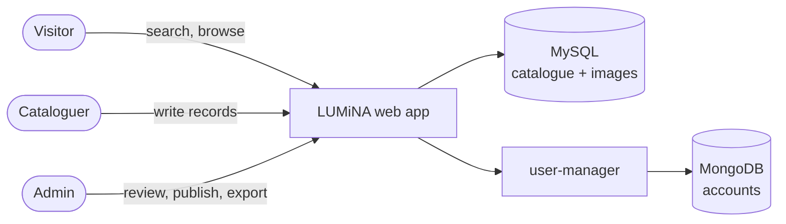

# LUMiNA

**Digital catalogue of the works of the [Musei Nazionali di Lucca](http://www.luccamuseinazionali.it/).**

Cataloguers describe artworks with rich, linked records. Visitors search the catalogue and browse the links between works, authors, places and exhibitions.

> Status: advanced prototype. Six demo records with images load automatically on first start.



## Features

| For | What they get |
|---|---|
| **Visitors** | Search with suggestions plus advanced search by field · indexes by author, material, place, exhibition… · record page with gallery and a **size comparison** silhouette (person or hand) · Italian/English UI chosen from the browser · watermarked previews only · **no cookies, no tracking** |
| **Cataloguers** | Tabbed editor · **shared authority entries** (authors, materials, places…) with duplicate warnings · insert the record's own images into long texts · submit for review; records sent back arrive with the admin's message, to fix and resubmit or delete |
| **Admins** | Approve, reject or send back records (they never create, edit or delete them) · **database overview** (completeness map of every field, table structure, use of entries) · user management · merge duplicate entries · daily backups · **Excel export** and **photo export** (ZIP) |

## Try it in 2 minutes

You need **Docker** (Compose v2) and `make`.

```bash
git clone https://github.com/bianchi-john/LuminaReborn.git
cd LuminaReborn
make up            # then open http://localhost:3000
```

| Role | User | Password |
|---|---|---|
| Admin | `admin` | `admin` |
| Cataloguer | `pasquale`, `elena`, `virginia` | `schedatore` |

`make reset-demo` starts over from the demo data. `make` lists every command.

## Documentation

| | |
|---|---|
| [docs/INSTALLATION.md](docs/INSTALLATION.md) | Install, configure, back up, update, go to production |
| [docs/DEVELOPMENT.md](docs/DEVELOPMENT.md) | Dev environment, architecture, data model, search, i18n, tests |
| [docs/SECURITY.md](docs/SECURITY.md) | Security and compliance (OWASP, GDPR, AgID), checks, residual risks |
| [docs/IMPROVEMENTS.md](docs/IMPROVEMENTS.md) | Roadmap |
| [docs/Doc/](docs/Doc/) | **Original documentation** of the website (historical, Italian) |

## Stack

Node.js 22 + TypeScript, Express, server-rendered EJS, Bootstrap 5 · Playfair Display (titles) and Inter (text), served by the site itself · MySQL 8.4 (catalogue, plus image files in a separate database) · MongoDB with [user-manager](https://github.com/maximemoreillon/user_manager) for accounts · everything in Docker.

Comments and documentation are in English. Identifiers, database names and UI strings keep Italian domain terms (`scheda` = record, `voce` = authority entry, `opera` = work). Italian UI strings double as translation keys.
