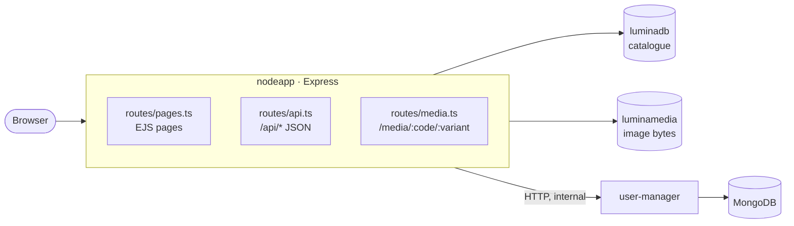
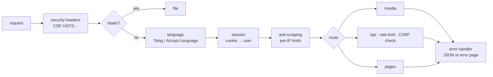
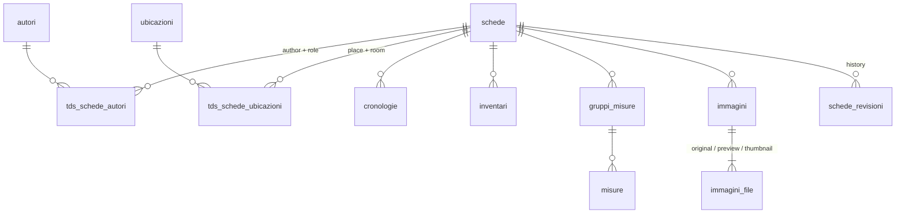
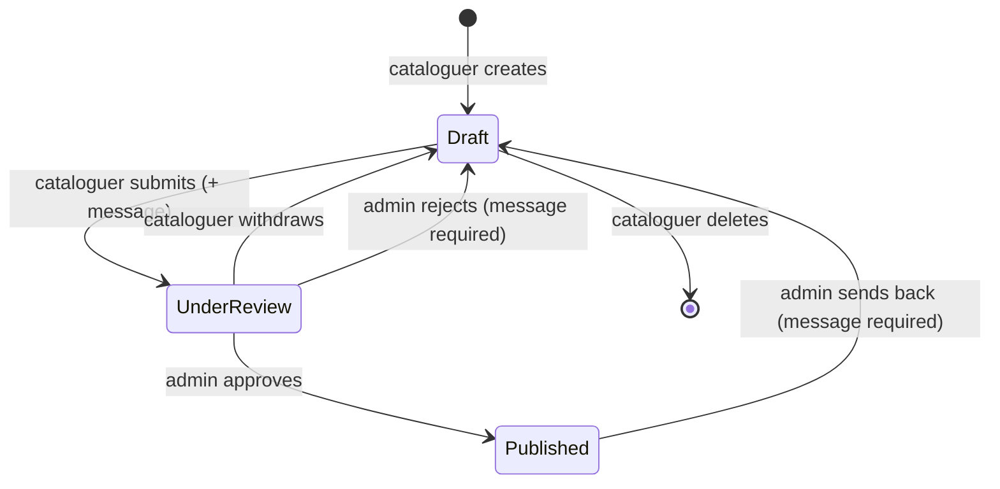
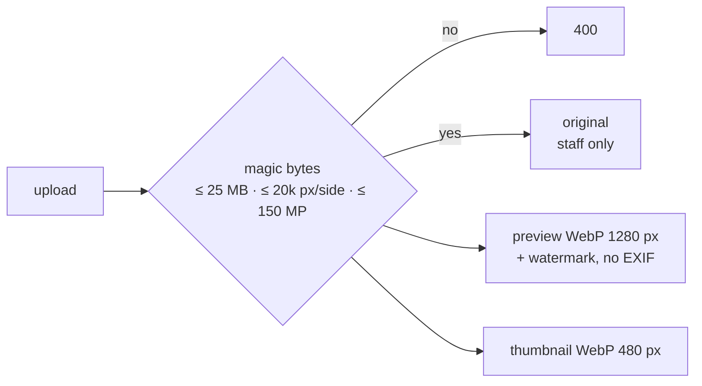

# Developer guide

## Dev environment

```bash
make dev      # whole stack, app with hot reload (docker-compose.dev.yml)
```

| You edit | You see it |
|---|---|
| `src/**/*.ts` | auto-restart in about 1 s (`tsx watch`) |
| `views/`, `public/` | reload the page (no cache in dev) |
| `migrations/` | `make restart` |
| `package.json` | `make dev` again (rebuilds the image) |

| Command | |
|---|---|
| `make typecheck` · `make test` | types · unit tests (`node:test`) |
| `make test-e2e` | end-to-end tests against the running instance (creates, publishes and deletes a test record) |
| `npm run i18n:check` | UI strings missing an English translation |
| `make db` | MySQL console (`127.0.0.1:3306`) |

CI (`.github/workflows/ci.yml`) runs the typecheck, the tests, `npm audit` and the image build.

## Architecture



Every request goes through the middleware chain in `src/app.ts`, in this order:



```text
src/
  index.ts      boot: wait for DB, migrations, scheduled jobs, HTTP server
  app.ts        middleware chain, template helpers
  config.ts     environment variables with defaults and checks
  auth/         session (cookie → user), user-manager client
  domain/       pure rules: vocabularies, record validation, size comparison
  services/     data access: records, entries, search, images, Excel
  routes/       pages, API, media
  http/         errors, security headers, CSRF, rate limits, anti-scraping
  i18n/         en.json and key extraction
  db/           MySQL pool, migrator, code migrations
  util/         HTML sanitising, text similarity, public codes
views/          EJS templates (partials/, area/ = staff area)
public/js/      ES modules, no build step (lib/ = shared)
migrations/     numbered SQL migrations
dbinit/         original schema + demo data (first MySQL boot only)
```

| I want to… | Touch |
|---|---|
| add a record field | migration + `domain/scheda.schema.ts` + `services/schede.service.ts` + `views/area/editor.ejs` / `public/js/editor.js` + `views/scheda.ejs` |
| add a shared vocabulary (e.g. "Patrons") | migration (table + link table) + one entry in `domain/vocabolari.ts`. Validation, saving, API, indexes and autocomplete adapt automatically; then add the editor panel |
| change search fields | `services/search.service.ts` + form in `views/home.ejs` |
| change a UI string | the Italian text in the template/script + its translation in `src/i18n/en.json` |
| change permissions | `computePermessi` in `services/schede.service.ts` (unit-tested) |

## Data model



- **Shared entries (authority files):** `autori`, `materiali`, `tecniche`, `ubicazioni`, `provenienze`, `mostre`, `bibliografie`, `altreBibliografie`. Each entry exists once (`UNIQUE` key) and links to records through `tds_schede_*` tables. Those link tables also hold per-work data: the author's role (`formula_precedente`, `categoria`), the room (`collocazione`) and notes. Saving a record reuses an identical entry (`ON DUPLICATE KEY UPDATE id = LAST_INSERT_ID(id)`). The editor warns about similar entries (`util/similarity.ts`), and admins merge duplicates in *Vocabularies*.
- **Per-record data** (`cronologie`, `inventari`, `gruppi_misure`/`misure`, `immagini`…) cascades on delete.
- **Images:** metadata in `luminadb.immagini`, bytes in `luminamedia.immagini_file`.
- **Public codes:** works and images get a random code (10 and 16 chars, `util/codici.ts`). Numeric IDs stay inside the staff area.
- **Migrations:** `migrations/NNN_name.sql` plus code steps in `db/codeMigrations.ts`. They run in name order and are recorded in `schema_migrations`. Never edit a released migration; add a new one.

### Record workflow



**Separation of duties** (`computePermessi`): no account can do everything. Cataloguers write records: they create them, edit and delete their own drafts, and submit them. Administrators review: they approve or reject submitted records, and can send a published one back at any time. They never create, edit or delete record content (API and pages answer 403). A record can only be sent back if a cataloguer can take it over.

`schede.stato`: 0 draft, 1 under review, 2 published. Every step and its message goes to `schede_revisioni`, and the cataloguer's dashboard flags records sent back.

### Database overview and exports

*Administration › Database overview* (`services/panoramica.service.ts`, `views/area/panoramica.ejs`):
- **completeness map:** one row per record, one column per field (`CAMPI`), in four levels from empty to rich;
- **table structure:** row counts and links;
- **use of shared entries:** published, drafts only, never used;
- **distributions:** by classification and by century.

It runs one grouped query per table, never one per record. To add a field to the map, add it to `CAMPI`.

*Administration › Export photos* (`services/foto.service.ts`) streams a ZIP: one folder per work, images stored as they are, and `catalogo-foto.xlsx` listing every photo. Images are read one at a time, so memory stays flat whatever the archive size. For very large archives use `make export-foto` (writes to `backups/foto`).

### Images



The public only gets `preview` and `thumbnail`. In long texts, the toolbar's ▣ button inserts one of the **record's own** previews. Pasted or dropped files are refused, and on save `soloImmagini` (`util/html.ts`) strips any image that doesn't belong to the record.

### Public URLs

```text
/opere/san-sebastiano-u63s7zaa3v      first words of the title (decorative) + random code
/media/3py23sfpzya5g9k5/anteprima     image code + variant
```

If the title changes, the old URL 301-redirects to the new one. `/scheda/:id` works for staff only.

## Search

- **Simple** (`q`) searches title, author, classification, description, commentary, location, provenance and collection history. Every word must match somewhere. Case and accents are ignored, singular and plural forms match, and title/author hits rank higher.
- **Advanced:** one criterion per field (AND). Selects where values are few; autocomplete for author and exhibition.
- **Suggestions** while typing, and "Did you mean" when nothing matches.

## Languages

Italian is the main language: Italian UI strings are the keys, and `t('Testo')` returns the English text from `src/i18n/en.json`. The language comes from `?lang=` or `Accept-Language`, never from a cookie. A unit test fails when a string has no translation (`npm run i18n:check` lists them). Record content is not translated.

Security details: [SECURITY.md](SECURITY.md).
