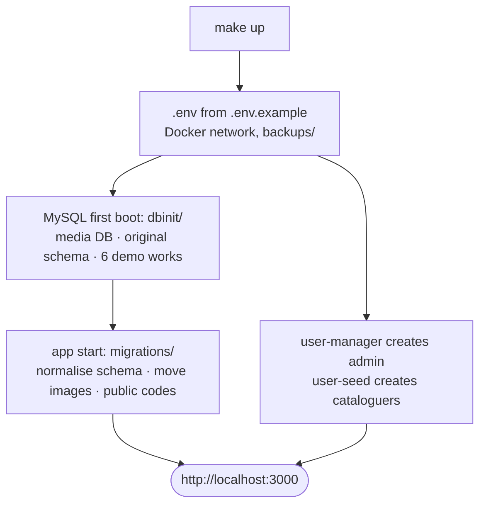
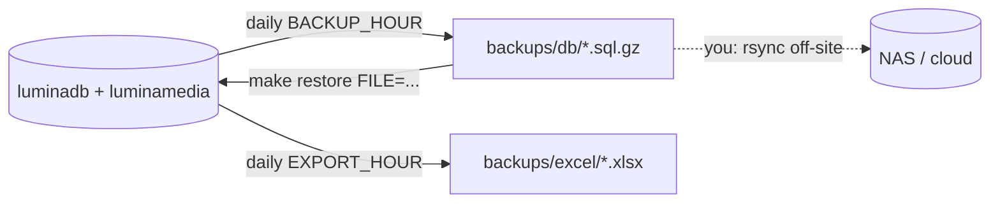

# Installation and operations

## Requirements

Docker Engine with Compose v2, `make` (optional: every target is a plain `docker compose` command in the `Makefile`), 2 GB RAM, a few GB of disk. You don't need Node.js on the host.

## First start

```bash
make up
```



The `dbinit/` step only runs when the data volumes are empty. Use `make ps` and `make logs` for status.

| Service | Role | Exposed |
|---|---|---|
| `nodeapp` | web app | `:3000` (`APP_PORT`, `APP_BIND`) |
| `mysqldb` | MySQL 8.4: `luminadb` (catalogue) + `luminamedia` (image bytes) | `127.0.0.1:3306` only |
| `backup` | daily dump of both databases | no |
| `mongo`, `user-manager-api` | accounts and login | internal network only |
| `user-seed` | creates the demo users, then exits | no |

## Demo data

There are six demo records with 22 images. Demo logins: admin `admin`/`admin`; cataloguers `pasquale`, `elena` and `virginia` with password `schedatore`. **Change them before any real use** (*Administration › Users*).

`make reset-demo` **erases everything** (records, images, users) and reloads the demo. It asks for confirmation; skip the prompt with `./scripts/demo-reset.sh -y`.

Data lives in Docker volumes (`mysql-data`, `mongo-data`). To use host folders instead, set `MYSQL_DATA_DIR` and `MONGO_DATA_DIR`.

## Configuration

Every variable is documented in [`.env.example`](../.env.example). The important ones:

| Variable | Purpose |
|---|---|
| `DB_PASSWORD`, `MYSQL_ROOT_PASSWORD`, `JWT_SECRET`, `ADMIN_PASSWORD`, `MONGO_*_PASSWORD` | secrets: **change them** (`openssl rand -hex 32`) |
| `COOKIE_SECURE` | `true` when served over HTTPS |
| `TRUST_PROXY` | number of reverse proxies in front of the app. ⚠️ **Required behind a proxy.** Otherwise every visitor shares the proxy's IP and the anti-scraping guard locks everyone out |
| `ALLOWED_ORIGINS` | public URL, e.g. `https://catalogue.example.org` |
| `MEDIA_PREVIEW_PX`, `MEDIA_WATERMARK` | size of public previews (1280 px) and their watermark text |
| `MAX_IMAGE_MB`, `MAX_IMAGE_LATO_PX`, `MAX_IMAGE_MEGAPIXEL` | upload limits: 25 MB, 20,000 px per side, 150 MP |
| `SCRAPING_*` | per-IP limits (see [SECURITY.md](SECURITY.md#anti-scraping)). `SCRAPING_PROTEZIONE=false` turns them off. To unblock an IP, run `docker compose restart nodeapp` |
| `BACKUP_DIR`, `BACKUP_HOUR`, `EXPORT_HOUR`, `BACKUP_KEEP_DAYS` | backups and exports |
| `NO_NEW_PRIVILEGES` | `true` by default. Set `false` only on Ubuntu hosts where Docker is installed as a snap: there AppArmor blocks the app's start (`exec … operation not permitted`) |

## Backup, restore, export



| | |
|---|---|
| Back up now | `make backup` (catalogue **and** images; verified with `gzip -t`) |
| Restore | `make restore FILE=backups/db/lumina-....sql.gz` (asks first, replaces current data) |
| Export Excel now | `make export` or *Administration › Export catalogue* |
| Export photos | *Administration › Export photos* (ZIP: one folder per work + `catalogo-foto.xlsx`), or `make export-foto` for large archives (`VARIANTE=anteprima` for the reduced versions), saved in `backups/foto/` |

The Excel file has one sheet with every record (one row per work, plain text) plus one sheet per vocabulary.

Backups stay on the same machine, so **copy `backups/` elsewhere**. User accounts (MongoDB) are not in the automatic backup:

```bash
docker compose exec mongo mongodump --archive --gzip > backups/users-$(date +%Y%m%d).archive.gz
```

## Updating

```bash
make backup && git pull && make up   # rebuilds and applies new migrations
make logs                            # look for "Migrazione database: ... completata"
```

Each migration is applied once and recorded in `schema_migrations`. MySQL DDL is not transactional, so if a migration fails, restore the backup.

**Installs older than v2** (data in `database-data/` and `user-data/`, MySQL 8.0):

- Demo data only: nothing to do. The new version uses volumes and reloads the demo.
- To keep existing data: set `MYSQL_DATA_DIR=./database-data` and `MONGO_DATA_DIR=./user-data/mongo-data`, run `make up`, then run `make grant-media` once (creates the image DB), `make mongo-auth` once (enables MongoDB auth), and finally `make restart`.

## Production checklist

`make verifica-produzione` checks the configuration items automatically. The reasons behind each item are in [SECURITY.md](SECURITY.md).

- [ ] New secrets; `.env` with mode `600`
- [ ] HTTPS reverse proxy (Caddy, Traefik, nginx); `APP_BIND=127.0.0.1` if the proxy is on the same host
- [ ] `COOKIE_SECURE=true`, `TRUST_PROXY=1`, `ALLOWED_ORIGINS=https://…`, `SECURITY_CONTACT=mailto:…`
- [ ] `make verifica-produzione` with no errors; `make scansione-sicurezza` with no warnings
- [ ] Demo users deleted or given new passwords
- [ ] Off-site backup copy and a tested restore
- [ ] Monitoring of `GET /healthz` and disk space
- [ ] `/privacy` and `/termini` completed (the parts in square brackets) and reviewed by the legal office

## Handy commands

```bash
make db                                   # MySQL console
docker compose logs -f backup             # backup results
docker compose -f docker-compose.yml -f docker-compose.user-front.yml up -d   # legacy user-manager UI (local only)
```
