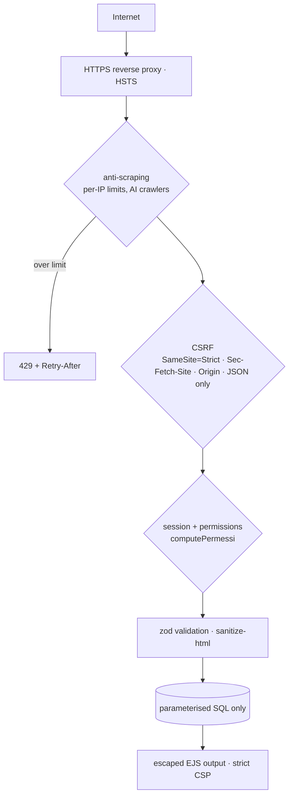
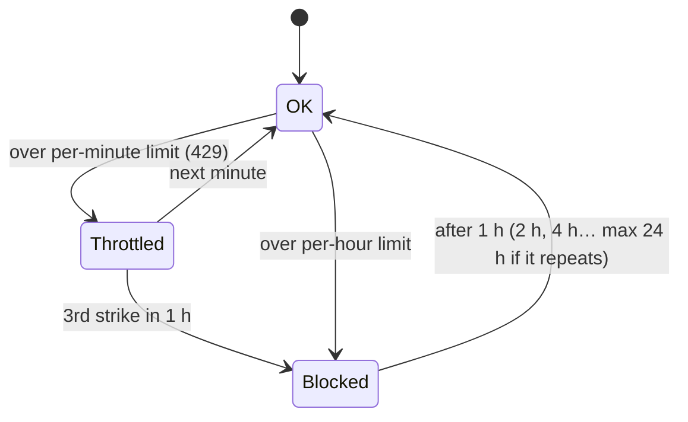

# Security and compliance

This document is for whoever has to assess the site (security office, DPO, external auditors). References: OWASP Top 10 (2021), ASVS 4.0 L1 (with L2 controls for sessions and logging), OWASP Secure Headers, GDPR arts. 5/25/32, Italian DPA cookie guidelines (10 June 2021), AgID minimum ICT security measures (circ. 2/2017), Law 4/2004 (accessibility).

## Verification results

| Check | How to repeat | Result |
|---|---|---|
| OWASP ZAP baseline | `make scansione-sicurezza` (report in `backups/zap/`) | 0 high/medium/low alerts (63 pass); remaining informational notes explained in `scripts/zap-regole.conf` |
| Unit tests (validation, sanitising, permissions, uploads, anti-scraping) | `make test` | pass |
| End-to-end (CSRF, permissions, headers, no cookies, login, password change, workflow) | `make test-e2e` | pass |
| Vulnerable dependencies | `npm audit --omit=dev` (also in CI) | one non-exploitable sharp/librsvg advisory (see residual risks) |
| Production config | `make verifica-produzione` | run on the server: catches demo passwords, missing HTTPS, `.env` permissions |

## Defence layers

## OWASP Top 10

| Risk | Measures |
|---|---|
| **A01 Access control** | **Separation of duties:** administrators review but never create, edit or delete records; cataloguers write but can't publish. No account has every privilege · server-side permissions for every action (`computePermessi`, unit- and e2e-tested) · other users' drafts return 404 · original images for authorised staff only · public URLs use random codes, so records and images can't be enumerated · no open redirects |
| **A02 Cryptography** | HTTPS + HSTS · cookies `Secure`, `HttpOnly`, `SameSite=Strict`, `__Host-` prefix · bcrypt password hashes (user-manager) · login always via POST · secrets only in `.env` (mode 600) |
| **A03 Injection / XSS** | Parameterised queries only; dynamic table names come from static config · zod schemas on all input · `sanitize-html` allow-list on rich text, both on write and on read · escaped output · CSP with no inline or external scripts/styles · uploads checked by magic bytes (no SVG) |
| **A04 Design** | Draft → review → publish with per-state permissions · least privilege (DB users, `cap_drop: ALL`) · rate and size limits · anti-scraping |
| **A05 Misconfiguration** | CSP, HSTS, X-Frame-Options DENY, nosniff, Referrer-Policy, Permissions-Policy, COOP/COEP/CORP · no stack traces · non-root, read-only container, `no-new-privileges` · MySQL on localhost only, user-manager/MongoDB on the internal network only · refuses to start over HTTPS with the demo DB password |
| **A06 Components** | Pinned versions (lockfile, image tags/digests) · `npm audit` in CI · Dependabot |
| **A07 Authentication** | Generic errors · attempt limits per IP and per username · 8 h absolute and 60 min idle session timeout · logout and password change revoke tokens server-side · password change needs the current one · login form CSRF token · blocked users rejected even with a valid token |
| **A08 Integrity** | `npm ci`, CI build · versioned migrations · backups verified with `gzip -t` |
| **Compression** | gzip for public pages and assets, but **not** for the login page and auth API, which carry a secret token (BREACH) |
| **A09 Logging** | `AUDIT` log lines: logins, failures, logouts, password changes, denials, user admin, deletions, state changes, merges, exports (no IPs, passwords or tokens) · per-record history · `/healthz` |
| **A10 SSRF** | The server only calls the configured user-manager URL; it never fetches a user-supplied URL |

## Anti-scraping

The guard lives in `src/http/antiscraping.ts`. It applies to anonymous visitors; logged-in staff are exempt.

| | per minute | per hour |
|---|---|---|
| pages | 60 | 600 |
| images | 600 | 6,000 |
| API | 300 | — |

Limits are set with `SCRAPING_*` in `.env`. IPv6 addresses are grouped by /64. AI training crawlers (GPTBot, CCBot, ClaudeBot, Bytespider…) are disallowed in `robots.txt` and get a 403. State is kept **in memory only** (at most 50,000 addresses), is forgotten when idle and is cleared on restart.

⚠️ Behind a reverse proxy, `TRUST_PROXY` **must** be set. Otherwise every visitor shares the proxy's IP.

## Privacy (GDPR)

- **Visitors:** no personal data collected, **no cookies**, no analytics, no third-party resources. The language comes from `Accept-Language` or `?lang=` and is never stored. The IP is held only in memory by the rate limits (minutes, or up to 24 h if blocked), never on disk or in logs. An e2e test asserts that public pages set no cookies.
- **Staff:** technical cookies only (session; a login-form CSRF token), which don't need consent and are described in the policy. Audit logs contain no IPs, passwords, tokens or record content.
- `/privacy` and `/termini` are drafts: the data controller details and a legal review are still to do.

## AgID minimum measures (excerpt)

| ABSC | In LUMiNA |
|---|---|
| 1-2 Inventory | components and versions in `package-lock.json` and `docker-compose.yml` |
| 3 Secure configuration | secure defaults, checked by `make verifica-produzione` |
| 4 Vulnerabilities | `npm audit` in CI, Dependabot, repeatable ZAP scan |
| 5 Admin privileges | separate roles, least privilege, admin actions audited |
| 10 Backups | daily, rotated, verified; tested restore (`make restore`) |
| 13 Data protection | minimised data, no tracking, originals never public |

**Accessibility:** semantic markup, keyboard navigation, labels and alt text, and "reduce motion" support. `/accessibilita` must link to the official AgID statement after a WCAG 2.1 AA assessment.

## Residual risks and actions before go-live

| # | Risk / action | Owner |
|---|---|---|
| 1 | HTTPS proxy, `COOKIE_SECURE`, `TRUST_PROXY`, `ALLOWED_ORIGINS`, `APP_BIND=127.0.0.1`, new secrets, clean `make verifica-produzione` | server admin |
| 2 | user-manager only allows alphanumeric passwords and has no 2FA (mitigated by limits, timeouts and revocation). Replace it (see [IMPROVEMENTS.md](IMPROVEMENTS.md)) | dev |
| 3 | sharp 0.35.4 librsvg advisory: not exploitable because SVG is rejected first. Upgrade and make the CI audit blocking | dev |
| 4 | The demo `JWT_SECRET` is in git history: treat it as public and replace it | server admin |
| 5 | Off-site, ideally encrypted, backups with periodic restore tests | server admin |
| 6 | Central log collection with retention and alerts | server admin |
| 7 | Complete privacy policy and terms; add to the processing register; data processing agreement with the host | controller / DPO |
| 8 | Accessibility assessment and AgID statement | controller |
| 9 | Independent penetration test before public launch | controller |

**Vulnerability reports:** set `SECURITY_CONTACT` (e.g. `mailto:security@example.org`). It is published at `/.well-known/security.txt` (RFC 9116).
